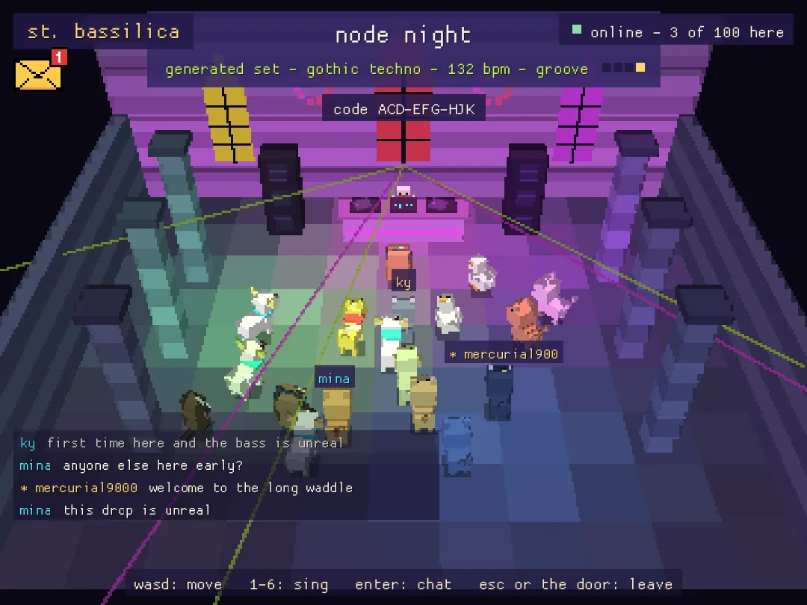
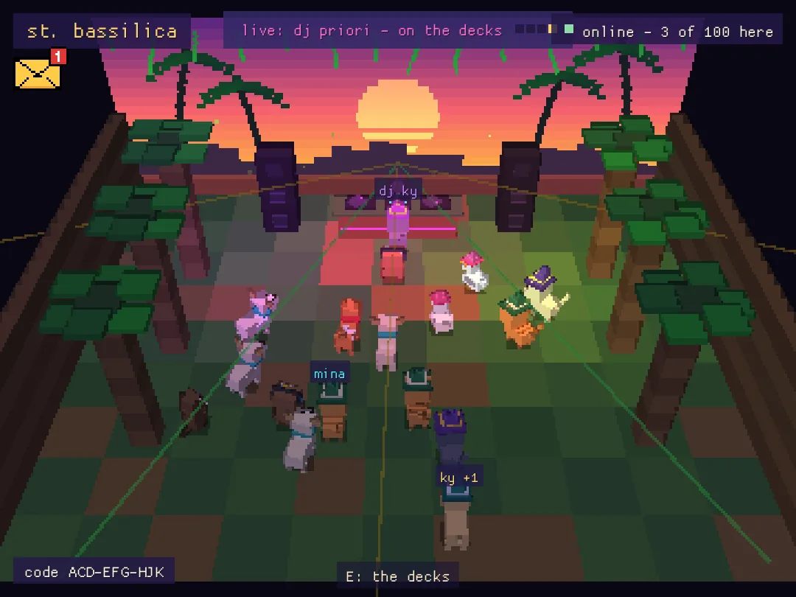

# Melody Quack



A cosy pixel game about animal friends making music. Your animal's voice is your instrument: jam by the campfire, fish on the beat, cook percussion, decorate your home, and at night find the secret code to the rave at St. Bassilica, where friends dance together online and DJs play live sets, from the in-game decks or straight from Serato.

Written in Rust with [macroquad](https://macroquad.rs). The world is chunky low-res 3D (about 360×270) with sharp full-resolution text on top. Every block, flame and meow is generated in code: no models, textures or sound files besides the icon.

**Play now:** https://kyurishin.github.io/melody-quack/

## Contents

- [Play](#play)
- [Controls](#controls)
- [Characters and your companion](#characters-and-your-companion)
- [Life at home](#life-at-home)
- [Making music](#making-music)
- [The town at night: PC bang, the post and the chapel](#the-town-at-night-pc-bang-the-post-and-the-chapel)
- [DJs](#djs)
- [Your name, saving and accounts](#your-name-saving-and-accounts)
- [Radio and the Serato bridge](#radio-and-the-serato-bridge)
- [Running the server](#running-the-server)
- [Building](#building)
- [How it's made](#how-its-made)

## Play

| Where | How |
| --- | --- |
| **Browser** | https://kyurishin.github.io/melody-quack/ (keyboard, or touch controls on phones and tablets) |
| **macOS** | `Melody-Quack-<version>.dmg`, for Apple Silicon and Intel. Drag the duck into Applications. It isn't notarised by Apple, so the first time: right-click the app, Open, Open (or System Settings, Privacy & Security, Open Anyway). If macOS says it is damaged, run `xattr -dr com.apple.quarantine "/Applications/Melody Quack.app"` |
| **Linux, any distro** | `Melody-Quack-<version>-x86_64.AppImage`: `chmod +x` it and run it. Or unpack `melody-quack-<version>-linux-x86_64.tar.gz` and run `./install.sh` (game, icon and menu entry under `~/.local`) |
| **Arch Linux** | `sudo pacman -U melody-quack-<version>-1-x86_64.pkg.tar.zst` |
| **From source** | `cargo run --release` |

The packages come from the Packages workflow ([Building](#building)); the Linux ones are for 64-bit Intel/AMD and need ALSA, X11 and OpenGL, which desktop systems have.

Every version connects to the rave server by itself. Without a connection everything still works offline: you just rave on your own.

On a phone, the web version shows a stick on the left, six note buttons and a big E on the right, plus **mode**, **emoji**, **back** (the same as Esc) and **more** for the rest. Turn the phone sideways for the best view.

## Controls

**One rule for every menu:** Esc closes whatever is open, and only pauses (or leaves the PC bang and the chapel) when nothing is. Clicking outside a panel closes it too. **E** does things, **M** is always your bag, and **Enter** is for typing (chat, codes, the terminal, your name). Typing never sets off game keys. Every panel's hint says how to close it, and **H** lists every key in the game.

| Key | Player 1 | Player 2 |
| --- | --- | --- |
| move | WASD (or arrows when alone) | IJKL (or arrows) |
| sing / cast | 1 2 3 4 5 6 (notes D E F# A B C) | 7 8 9 0 - = |
| act: sit, pick up, fish, cook, build, use furniture | E | O |
| build tool outdoors; turn or move furniture indoors | X | U |
| bag, quests, stored furniture | M | Backspace |
| pixel emoji | Z | . |
| close what's open, or pause | Esc | |
| help | H | |

| Key | Music and more |
| --- | --- |
| Tab | spell mode / music mode |
| R | record into the loop |
| C | clear the loop (player 2: Y clears only theirs); Shift+C makes your friend forget every tune |
| Q | quantise: off / soft / tight |
| B | beat on / off |
| F | follow: lock the tempo to music heard by the microphone |
| G | echo: notes repeat on the beat like a dub delay |
| T | tape: record everything you hear, T again saves a .wav |
| V | choose characters |
| P | one or two players (split screen outdoors) |
| N twice | fresh world |

**The pause menu** (Esc, or click the game) has a mixer (you, your friend, beat & pot, world, master) and buttons, each with its key: **fishdex (F)**, **restart (R twice)**, **dj set (J)**, **karaoke (K)**, **companion (C)** and **account (A)**.

## Characters and your companion

Press V (or start a new game) to choose who you are and who your friend is. W/S picks the row, A/D the character, E or Esc when done. Each animal has its own voice, so the six notes sound completely different:

| Character | Voice |
| --- | --- |
| cream cat | the classic soft meow |
| russian blue | a gentle, muffled meow |
| ginger tabby | a bright, short meow |
| black cat | a deep meow, an octave lower |
| labrador | a round woof |
| cream pup | a little yap |
| shiba | an "awoo" howl |
| duck | a buzzy quack |
| owl | a vocoder "hoo-hoo", with DJ headphones |
| fox | a hoarse, breathy bellow (with a teal scarf and a big bushy tail) |
| sea otter | smashes a shell on his belly, so every note is a tuned clack |

**Your companion** is a little AI bandmate. It fetches sticks for the fire, wood and stones for building and acorns for you; it sits by the fire and plays along (bass under you, its own improvised phrases, echoes of what you just played); it fishes next to you and sometimes saves a ring you missed. It also writes songs: a new game starts with an empty songbook, and every solo writes a new tune, grows one it knows or plays a favourite, up to eight tunes. When it solos, answer back.

Want to play alone? Pause and press **C** (or click the companion button): your friend goes to rest, disappears, and you fetch your own sticks. Playing by the fire on your own still earns stars. C again brings it back; the choice is saved. **P** turns the friend into a second player instead (see [Two players](#two-players)).

New players get a short guide in banners: sing your first note, find the fire, make a memory, and then **the rave tour**: open the envelope, go to the PC bang and sit at a computer, find tonight's code, take it to the chapel door, and say hello in the chat. Gold arrows float over the doors and the nearest computer, and a compass on the banner points the way. "skip" ends it.

## Life at home

### The campfire

A few trees have a stick at their foot, marked with a sparkle. Pick it up (E) and carry it to the logs by the fire; the first stick lights it, and each burns for about 45 seconds. Your friend keeps fetching. Sit by the fire with E: the sky turns to dusk, the windows glow, and you jam. E again puts the pot on (see [Cooking](#cooking-percussion)). Ember (1, in spell mode) relights the fire, rain (3) puts it out.

### Stars and the diary

Play together by the fire (both players, or you with your companion, or you alone with the companion resting) and keep the notes coming: 30 seconds earns one star, a minute two, three minutes three. Short pauses are fine. After 8 seconds of quiet, the jam goes in the diary with the date, who played, how long and the stars. Every jam is recorded note by note: pick one in the diary and the record player plays it back (the last 10 keep their recordings).

### Fishing on the beat

At the end of the dock, E casts. A ring shrinks around the bobber and closes on every second beat: press E as it touches the bobber, three times, to land one of 120 fish. A miss costs one of three tries; mashing locks you out of the ring. "perfect!", "nice!" and "too early" pop up above the ring. Your first fish comes with a lesson and can't get away. In two-player mode either player hitting a ring counts, and hitting it together counts double. The beat follows the loop tempo, so with F you can fish in time with the music around you.

**The fishdex** (pause menu, F) has all 120 species, #001 to #120: common, uncommon, rare and legendary (the koi family and the big ocean fish). Perfect timing makes rarer fish more likely. Type a name or number to search; uncaught fish are dark shapes.

### Mushrooms

Seven of 120 species grow near the trees each real day (more when it rains). Pick them with E. The mushroom dex (next to the fishdex) logs them all; some, like the fly agaric, are for looking only. Edible ones go in your basket for cooking. In real life, never eat a wild mushroom an expert hasn't identified.

### Cooking percussion

Sitting by the fire, E puts the pot on and 1-4 (player 2: 7-0) become a kitchen drum kit: kick, pot lid, chopping, sizzle. Every hit on the beat fills the pot; a full pot makes a dish from what you caught: campfire tea, grilled fish, fish stew, golden koi soup, and mushroom dishes. Serve them on your table at home.

### Building

Outdoors, face an empty square and press E to build: wood walls, stone walls (up to three high) and plank floors. X switches tools; remove gives the material back. Every block plays a note as it goes up.

### Your home and acorns

Walk to the cottage door to go inside. Earn **acorns** by shaking trees, jamming, fishing, cooking and from your friend's errands, then spend them at the **catalogue** in the corner (E): W/S switches tabs (catalogue, diary, fishdex, mushrooms), A/D browses, E buys, Esc closes. E places what you bought, X turns it; face a piece and X picks it up to move it (or sell it back for half at the catalogue). Wallpaper and floors cost 10 acorns once, then switch for free. Everything is saved.

**Make it bigger:** bigger room (80 acorns), even bigger room (160), penthouse loft (250, with stairs, a glass railing and a window over a harbour city that follows the real clock and weather), bigger penthouse (400).

**Furniture** (face it and press E):

- **lamp**, **red light**: on and off; every light that's on lights the room
- **bed**: sleep (the game saves); your friend hops in on the other side
- **sofa**, **concrete bench**: sit
- **plant**: water it once a day; it grows, blooms, and withers if forgotten
- **table**: serve a dish you cooked
- **bookshelf**: eight books (experience design, software development, electronic music, AI, UI/UX design, cook & quack, computer science, learning rust), ten pages of short true stories each. A/D choose and turn pages, E opens, Esc goes back
- **piano**, **drum kit**: sit and play with 1-6
- **record player**: plays your friend's tunes or a diary jam
- **wind chime**, **speaker** (bigger echo), **subwoofer** (heavier kick), **steel pillar** (clang), **rug** (a little dance)
- **dj booth**: first person on two turntables with a 132 bpm beat; 1-6 play pads, W/S tempo, A/D pattern (techno, house, breaks, classic, off), R records, Esc leaves. In two-player mode player 2 joins b2b with O
- **mirror ball** (300), **dance arcade** (500: arrows from the music on your mic, or the game's beat), **wall tv** (1000: five pixel visual channels), **sampler** (180: a 16-step grid, Space records your own sound into a row)
- **techno club set** (free): one tap turns the room into a concrete club

**Putting things away:** while carrying a piece, M puts it in your bag. In the bag at home, W/S picks a stored piece, E takes it out, X twice packs everything. Room upgrades store pieces that are in the way.

**Daily quests:** three a day (fish, mushrooms, cooking, watering, sticks, notes, emojis, stars, dancing), in your bag with their acorn rewards.

### Real time, seasons and weather

The world follows your clock: morning, day, sunset, dusk and night with stars and a moon. Seasons follow the date (blossom, green, orange, snow). In the browser the weather comes live from [Open-Meteo](https://open-meteo.com) for your location (or Hamburg if you say no), with real sunrise and sunset; the desktop version makes up weather to suit the season.

### Pixel emoji

Z (player 2: .) shows a pixel emoji above your head; press again to step through twelve, and it sends after a second (or click one).

### Two players

Press P for local co-op on one keyboard: the screen splits outdoors, and you share the world, bag, house, loop and diary. Both can gather, build, sit, cook, fish (hit rings together for double), use every piece of furniture and go b2b at the DJ booth. Player 2's notes show in golden brown on the loop grid.

## Making music

- **Notes:** 1-6 sing in your animal's voice (D, E, F#, A, B, C), so anything you play sounds good together.
- **The loop:** two bars of 16ths. R records, and recording again layers more on top. Loops keep playing while you explore.
- **Quantise (Q):** off (pure you), soft (recordings pulled halfway to the grid, the default), tight (snapped to the grid).
- **Beat (B), echo (G), tape (T):** kick, clap and hats; a dub delay on the beat; a .wav of everything you hear (desktop: `~/Music/melody-quack/`, browser: a download). A tape stops itself after five minutes.
- **Mic sync (F):** the game listens, finds the tempo (80-160 bpm) and locks the loop to the music in the room, usually within five seconds. Amber means syncing, green means synced.
- **Spells (Tab):** in spell mode the notes are ember, bloom, rain, gust, frost and sun. Fire spreads to dry grass downwind and leaves ash, wet tiles don't burn, frost makes water walkable, sun melts ice. Nothing is scripted: puzzles come from how the rules combine.

## The town at night: PC bang, the post and the chapel

**The PC bang** is the dark building with the neon sign. Sit at a computer (E) to use Quack 95:

- **rave.exe** books a rave: name, sound, tempo, and you get a code and a pixel flyer.
- **quacknet** is the town's web; a tiny dot on the home page leads underground, where the flyers hang.
- **terminal** hides a capture the flag whose flag is tonight's rave code. Type `help`. (Players called leon or neomole get a harder hunt: git history, a JSON web token and an API.) Drag to select text, click a word to copy it, Ctrl/Cmd+C copies, Ctrl/Cmd+V or right-click pastes, and up/down bring back commands.
- Mr. Kim at the counter has opinions.

**The post:** the envelope at the top left has the goose's announcement of tonight's secret rave, with a countdown to the millisecond. A red 1 means news.

**The secret rave:** the goose writes the code down exactly 30 minutes before doors. The 30 players who sit down at a PC bang computer closest to that moment (within ten seconds, one try, the game says how far off you were) get the first go at it in the terminal. Five minutes later the terminal gives it to 70 more. The goose lets nobody in before the start, and the chapel holds 100.

**St. Bassilica**, the concrete chapel at the end of the forest path: the board outside carries flyers (old torn ones no longer work). Give the goose a code at the door (type it, paste it, or click one you've seen). Inside: a generated techno set seeded by the rave, a dancing crowd, and everyone who came, with names over their heads (blue ravers, purple DJs, the admin in gold with a star). You hear each other sing, and the set is in sync for everyone.

**Chat:** Enter opens it, Enter sends, Esc closes; phones have a "chat" button. Messages fade after about fifteen seconds and coloured names match the name tags. Offline, your message only shows on your screen, with a note saying so.

## DJs

DJs are members of a 5 euro a month Patreon tier. Each gets a **DJ key** from the admin.

- **Signing in:** on the name screen (the first time, or after restart), press "become a dj" and type the key. DJs show as "dj name" in purple.
- **Asking to play:** in the chapel, E at the booth opens the decks; ask to play the rave that's on. The request goes to the admin's post, and every yes is good for one set and earns the DJ 1 euro of credit, shown at the decks.
- **Playing:**
  - **in-game decks:** beat and melody on or off, the sound, the tempo, and six pads; everyone in the room hears the same mix.
  - **from this computer** (desktop app): click "input" until it shows the input carrying your sound, then "from this computer". The game streams it (128 kbps MP3) through the server to everyone in the room, in the browser and the desktop apps, a couple of seconds behind like any radio. A meter shows your level. To play **Serato DJ Pro**: many controllers show their master output as a recording input; otherwise route Serato through a loopback device (BlackHole on the Mac is free) and pick that.
  - **a stream link:** paste any https stream under "real audio".
- **The look of the room:** while live, "look" changes the chapel for everyone: gothic chapel, jungle at sunset, a terrace over San Francisco, or a red room in black, red, neon and chains.
- **Practice:** offline, anyone can practise on the decks; only you hear it.



**The admin** signs in with the admin key in the same box and shows as a gold name with a star.

- The decks in any room are yours straight away, without asking; going live takes over from a DJ who is playing.
- The envelope gets three tabs:
  - **post:** the goose's news.
  - **requests:** "yes +1" or "no" for each DJ request, and "paid" to clear credit you've paid out.
  - **djs:** type a name and press "new dj key" to make a key (with a copy button); "remove" (click twice) takes a DJ off the list.
- In chat, `/mute <name>` and `/unmute <name>`; nobody else can use the admin's name.

The game never moves money: credit is a number the admin settles by hand.

## Your name, saving and accounts

- **Your name** is asked once, before anything else. Friends see it above your head; a second player on the same keyboard shows as "name +1".
- **Saving** happens by itself every few seconds and when you close the game (desktop: `~/.melody-quack/save.txt`, browser: local storage).
- **Restart** (pause menu, R twice) erases the game on this device and starts again from the name screen, keeping only your DJ key and sign-in.
- **Sign in** (name screen, or pause menu A) with Google, Steam or Apple to keep your game on the server: it survives a lost computer and moves between computers. On the name screen a saved game loads straight away; in the middle of a game it asks first whether to load the saved game or keep this one. While signed in, the game is saved to your account about every 30 seconds. (Which sign-ins appear depends on the server; Proton Mail has no sign-in for other apps.)

## Radio and the Serato bridge

**The radio** sits under the web version. Pick a station and press play; the track name shows in the game's top bar. SoundCloud stations name their tracks themselves; Mixcloud mixes use a tracklist with start times, and a BPM locks the game's beat to the mix. The station list is `web/sets.js` (`MELODY_SETS`); listeners can add their own under "add a mix".

**The Serato bridge** (`bridge/serato_live.py`) shows the tracks loaded in Serato on your laptop in the game: in the top bar, under the game and on your home DJ booth. It can also listen to your speakers, recognise the song (like Shazam), suggest tracks that go with it, and show synced karaoke lyrics from [LRCLIB](https://lrclib.net). It works with the game at http://localhost:4747 (served by the bridge) and your GitHub Pages site.

1. Open Serato and load a track.
2. In the game folder, run `python3 bridge/serato_live.py` (for recognising songs use Python 3.10 or newer with `pip install shazamio sounddevice`, for example `python3.12 bridge/serato_live.py`).
3. Open http://localhost:4747, go home, and press E at the DJ booth.

Options: `--debug` (what it sees in Serato), `--list-devices` and `--device` (which input to listen on, e.g. a BlackHole loopback), `--listen-every`, `--no-listen`, `--offline` (keep track names on your laptop; otherwise they're sent to your Pages site through [ntfy.sh](https://ntfy.sh) on the channel in `MELODY_LIVE.topic`), `--database` / `--serato` (an unusual library location). The pause menu's **DJ set** switch (J) shows both Serato decks; **karaoke** (K) shows the lyrics. The bridge shows names only; the music plays from Serato.

## Running the server

Online play needs the small server in `server/`: rooms, chat, the timed rave, DJs, live audio, sign-in and cloud saves. The live one runs on Fly.io as `willow-coral-204` (`wss://willow-coral-204.fly.dev`); `server/SETUP.md` explains setting up and updating it, and `server/fly.toml` is ready to use. Builds connect to it by default: the packages and web workflows use the repository variable `MQ_SERVER` if it is set, otherwise that address. On one computer you can point the game elsewhere with `MELODY_QUACK_SERVER` or `~/.melody-quack/server.txt`.

```
cd server
cargo run --release -- --port 7777 --djs djs.txt --admin '<admin key>' --admin-name <name> --public-url https://your.server
```

| Option | Variable | What it is |
| --- | --- | --- |
| `--port` | `PORT` | port for websockets and the web pages (default 7777) |
| `--public-url` | `MQ_PUBLIC_URL` | the server's https address; needed for sign-in and live audio links |
| `--admin` | `MQ_ADMIN` | the admin key |
| `--admin-name` | `MQ_ADMIN_NAME` | the name the admin shows as |
| `--djs` | `MQ_DJS` | the DJ list, `name = key` per line (the admin's djs tab edits it) |
| `--credits` | `MQ_CREDITS` | where DJ credit is kept |
| `--patreon` | `MQ_PATREON` | the page "join on patreon" opens |
| `--accounts` | `MQ_ACCOUNTS` | folder for sign-ins and cloud saves |
| `--google-id`, `--google-secret` | `MQ_GOOGLE_ID`, `MQ_GOOGLE_SECRET` | Google sign-in (an OAuth "web application" client with redirect `https://your.server/auth/google`) |
| `--apple-id`, `--apple-team`, `--apple-key-id`, `--apple-key` | `MQ_APPLE_*` | Apple sign-in (Apple Developer Program: a Services ID with return URL `https://your.server/auth/apple` and a `.p8` key) |
| `--every`, `--rave`, `--rave-in` | | when the secret rave starts: every N minutes (default 240, on the hour UTC), at a unix time, or in N seconds |

Steam sign-in needs no keys, only `--public-url`. Keep keys and passwords in the host's secrets, never in this repository. The server also answers plain web requests on the same port: `/login/...` and `/auth/...` for sign-in, and `/live/<code>.mp3` for a room's live audio.

## Building

- **Desktop:** `cargo run --release`. On Linux you need the ALSA, X11 and OpenGL development packages (`libasound2-dev libx11-dev libxi-dev libgl1-mesa-dev` on Debian/Ubuntu) and a C compiler (for the MP3 encoder).
- **Web:** `cargo build --release --target wasm32-unknown-unknown`, then copy the `.wasm` into `web/` next to `index.html`. Pushing to `main` builds and deploys GitHub Pages (`.github/workflows/pages.yml`).
- **Packages:** `.github/workflows/packages.yml` builds the macOS .dmg (`packaging/macos/make-dmg.sh`), the Linux tarball and AppImage (`packaging/linux/make-linux.sh`) and the Arch package (`packaging/arch/PKGBUILD`) on every push. Starting it by hand puts them in a draft release; pushing a `v*` tag publishes a release.
- **Server:** `cd server && cargo test` and `cargo build --release`; `server/Dockerfile` builds an image.
- **Tests:** `cargo test` (game), `cd server && cargo test` (server), `python3 -m unittest discover -s tests -v` (source checks).

Notes for contributors are in `HANDOFF.md`. The game's MP3 encoder is LAME (LGPL); with the source public, anyone can rebuild it with their own LAME.

## How it's made

- The world renders into a roughly 360×270 texture with depth and scales up with nearest-neighbour filtering; text and menus are drawn afterwards at full resolution so they stay sharp.
- Everything is built from coloured boxes every frame: the animals, the cottage, the fire, the chapel, the crowd, even the fishing line.
- Faces are shaded from a fixed light, with distance fog, an evening tint and flickering campfire light; trees and walls between the camera and you turn see-through.
- Every meow, woof, drum, sizzle, splash and crackle is synthesised at startup and mixed by a tiny built-in mixer (desktop) or Web Audio (browser).
- Mic sync finds onsets in the low end, autocorrelates them for the tempo and phase-locks the loop.
- The online server is a small Rust program (tokio, websockets) that relays rooms and chat, runs the timed rave, and streams DJs' audio.
