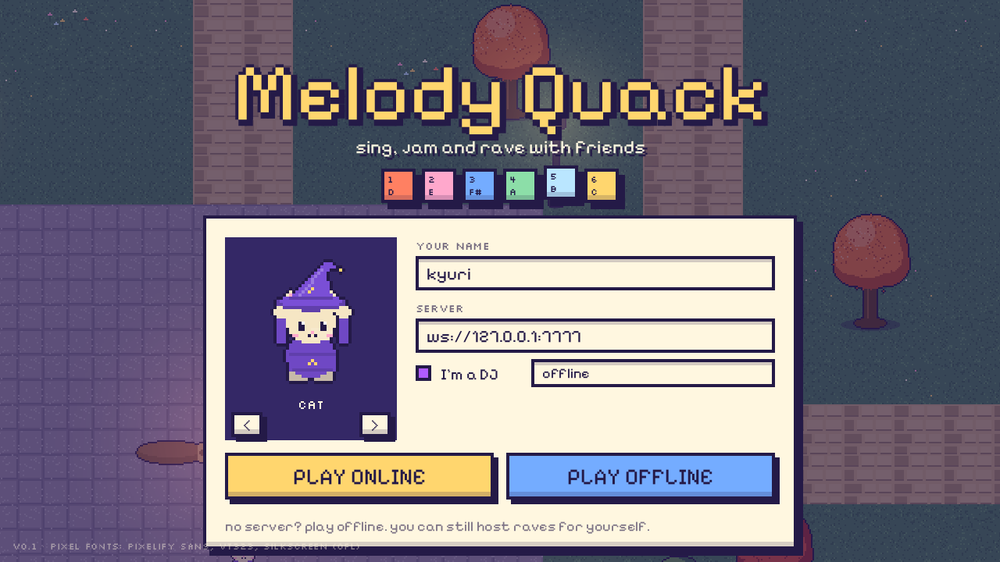
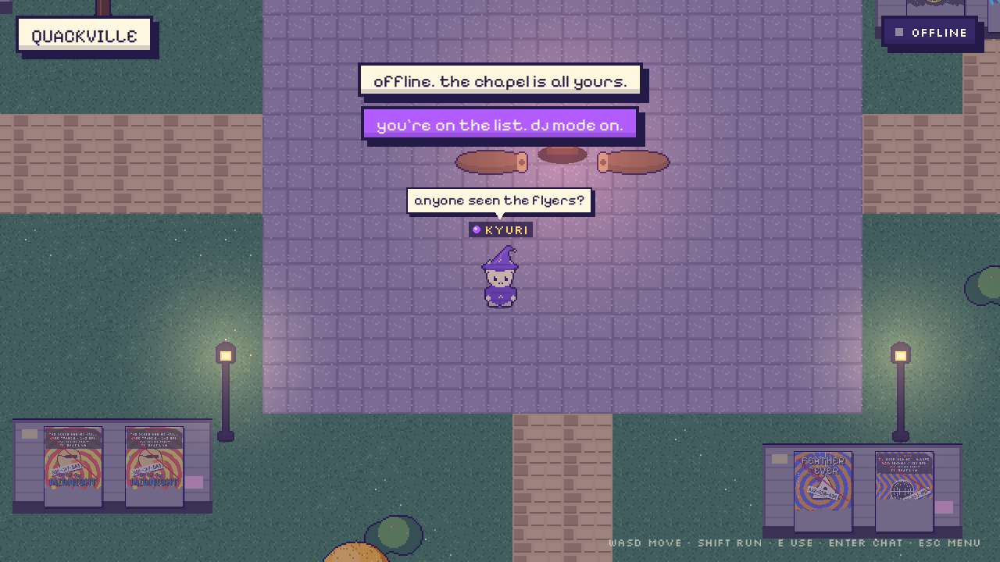
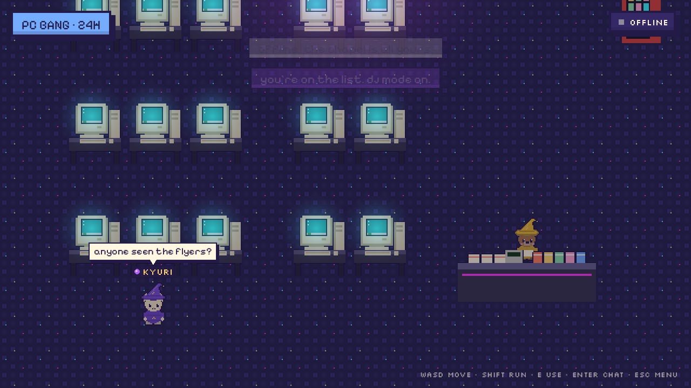
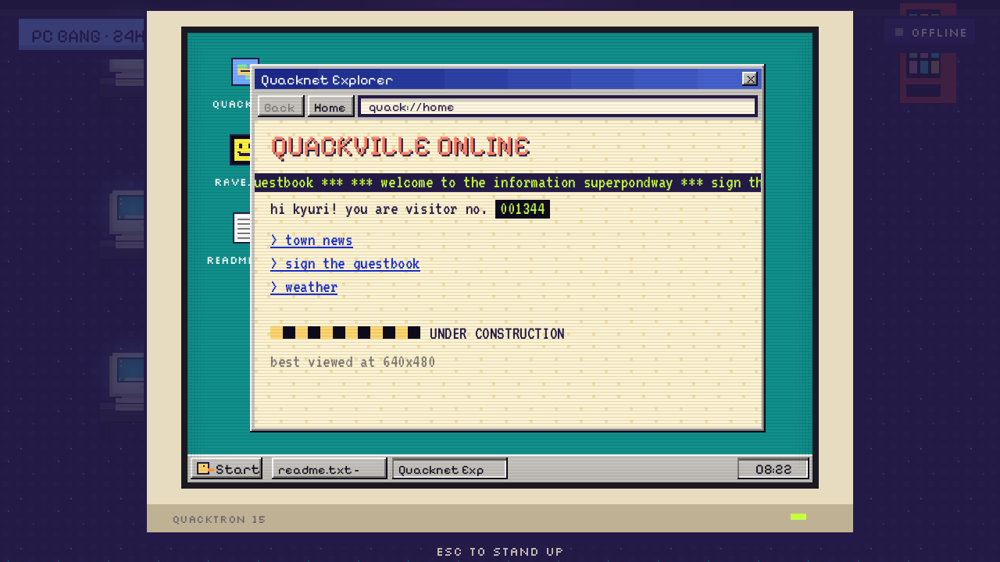
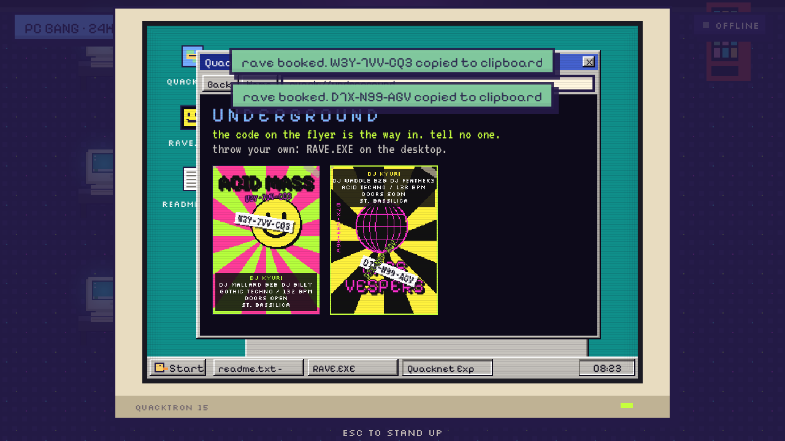
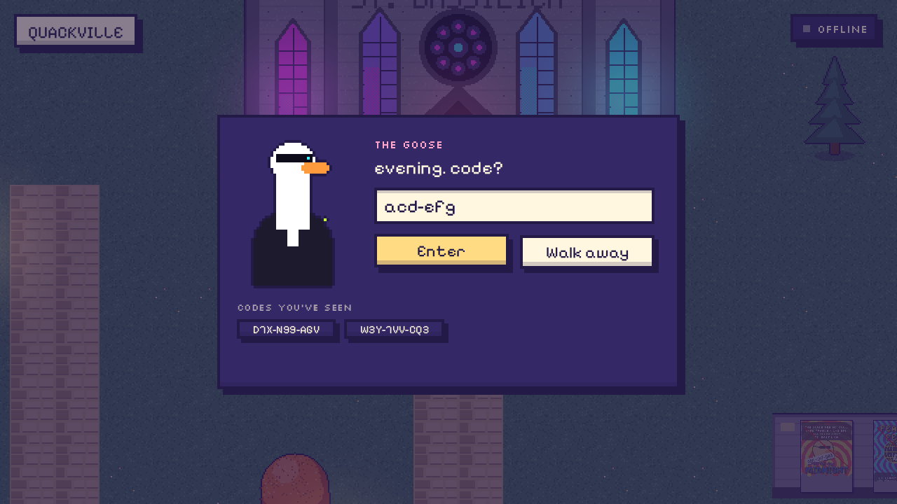
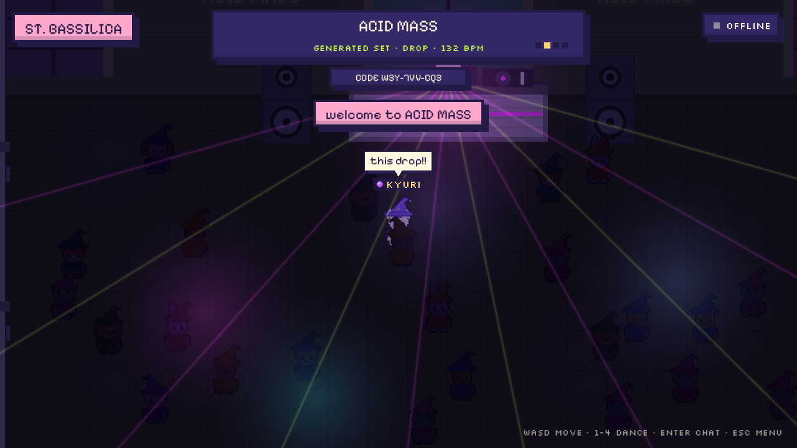

# Melody Quack

A cosy pixel town where friends meet online, hang out in a 24-hour PC방 and
rave together in **St. Bassilica**, a gothic-brutalist chapel turned techno club.



| Town | PC방 | Quack 95 |
| --- | --- | --- |
|  |  |  |
| **Underground flyers** | **The bouncer** | **The rave** |
|  |  |  |

## How a night works

1. **Go to the PC방** and sit at any of the fat beige CRTs. They run *Quack 95*:
   a teal desktop, bevelled windows, a Start menu and a taskbar clock.
2. **Open RAVE.EXE** to book an event. You get a Zoom-style code such as
   `QK7-MAX-9PE`, copied to your clipboard, plus a generated 90s rave flyer.
3. **Spread the word.** Send the code to friends, or tick *paste flyers around
   town*. Flyers with the code scrawled on top at random spots and angles then
   turn up on the hoardings, on the chapel wall and on a secret page in
   Quacknet Explorer. (Hint: there's a tiny dot at the bottom of the home page.)
   Old, torn flyers from past nights hang there too, and their codes don't work.
4. **Give the code to the goose** at the chapel door. Inside it's dark, with
   lasers, fog, stained glass pulsing on the kick, and a crowd. Dance with 1–4.

### Music

- **No DJ playing:** the chapel's own sound system plays **generated techno**
  (Acid, Gothic or Hard Trance). The rave's code seeds it, and it's synced to the
  server clock, so everyone in the room hears the same bar at the same time. A
  64-bar arc runs through intro, groove, acid, breakdown, drop, peak and cool-down.
- **A DJ playing:** players on the server's DJ list have a **purple dot** next
  to their name. When a DJ hosts an event, they can step up to the decks and
  **GO LIVE**. The game captures an audio input and streams it as Opus
  (160 kbps, 48 kHz stereo) to everyone in the arena. The generated set fades
  out, and the lights follow the live audio.

### Playing a Serato set live

Serato doesn't share its audio with other apps directly, so route it through
an input:

1. Install [BlackHole 2ch](https://existential.audio/blackhole/) (free) on your Mac.
2. In Serato, set the master output to BlackHole. To hear yourself too, use a
   Multi-Output Device in *Audio MIDI Setup* (BlackHole + your headphones), or
   cue on your controller.
3. In Melody Quack, walk up to the decks in your own event, pick **BlackHole 2ch**
   (it's preselected if found) and press **GO LIVE**. macOS asks for microphone
   permission the first time, because that's how it labels any audio input.

With a hardware mixer, you can instead plug its record/booth out into your
interface and pick that input.

## Controls

| | |
| --- | --- |
| Move | WASD / arrows (shift to run) |
| Use | E or space |
| Chat | Enter |
| Dance (in the chapel) | 1 2 3 4 |
| Menu | Esc |

## Running it

```bash
cargo run --release -p mq-server -- --djs djs.txt
```

```bash
cargo run --release -p melody-quack
```

Enter `ws://<server-ip>:7777` as the server on the title screen, or press
**Play offline** to explore alone (offline, any DJ key makes you a DJ, which is
handy for testing).

Linux needs `libasound2-dev libx11-dev libxi-dev libgl1-mesa-dev cmake` to build.

### The DJ list

Copy `djs.example.txt` to `djs.txt` and add one `name = key` per line. A player
who ticks *I'm a DJ* and enters a key joins under that DJ name with the purple
dot. Nobody else can take a listed DJ's name.

### Hosting the server

The `Dockerfile` builds just the server. It listens on `$PORT` (default 7777)
and speaks plain websockets. Behind a TLS proxy, players use `wss://`.

## The macOS app (.dmg)

GitHub Actions (`.github/workflows/macos-dmg.yml`) runs the tests and builds a
universal (Apple Silicon + Intel) `Melody-Quack.dmg` on every push. Download it
from the run's **Artifacts**. Pushing a `v*` tag attaches it to a GitHub Release.

Set a repository variable `MQ_DEFAULT_SERVER` (e.g. `wss://quack.example.com`)
to bake your server address into the build.

The app is ad-hoc signed but not notarised. The first time, right-click it,
choose **Open**, then **Open** again. Or clear the quarantine flag:

```bash
xattr -dr com.apple.quarantine "/Applications/Melody Quack.app"
```

To build the .dmg on your own Mac:

```bash
cargo build --release -p melody-quack --target aarch64-apple-darwin && packaging/macos/make-dmg.sh
```

## Layout

| Crate | What |
| --- | --- |
| `shared` | Protocol, rave codes, seeded RNG and the `Hub` (all multiplayer state; also runs in-process for offline play) |
| `server` | Websocket relay around the hub, including Opus packet forwarding |
| `game` | macroquad client: sprites drawn in code, UI kit, Quack 95, flyer generator, synth, audio capture and streaming |

`MQ_AUTOPILOT=<dir> cargo run -p melody-quack` plays through every screen and
saves screenshots there.

## Credits

Pixel fonts: Pixelify Sans, VT323 and Silkscreen, all under the SIL Open Font
License (see `game/assets/fonts/`).
